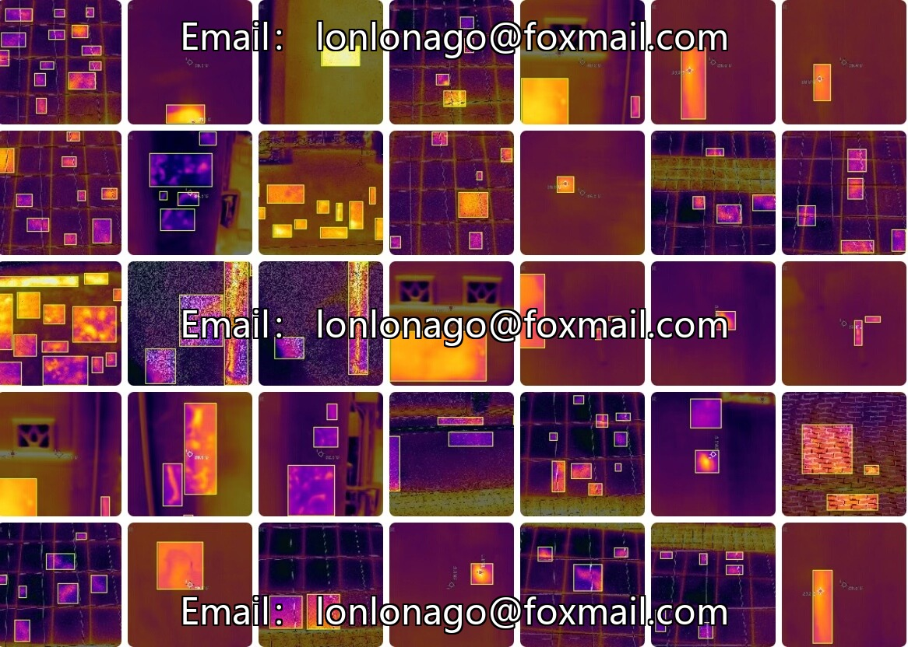
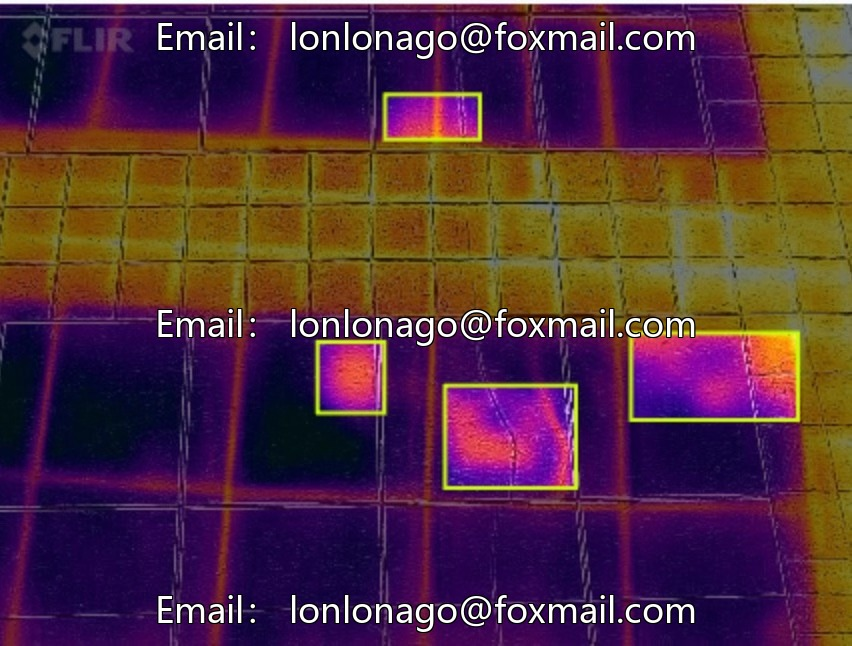
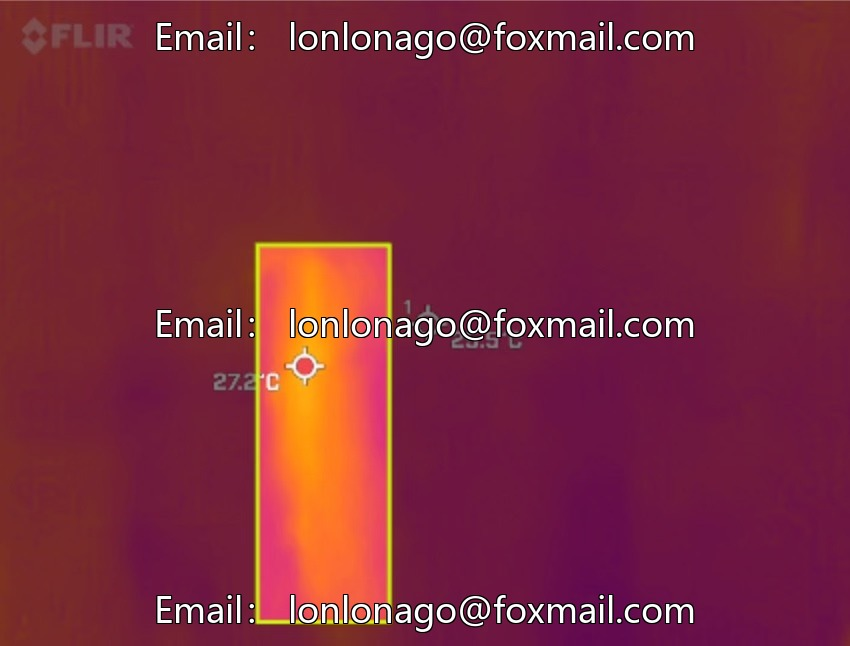
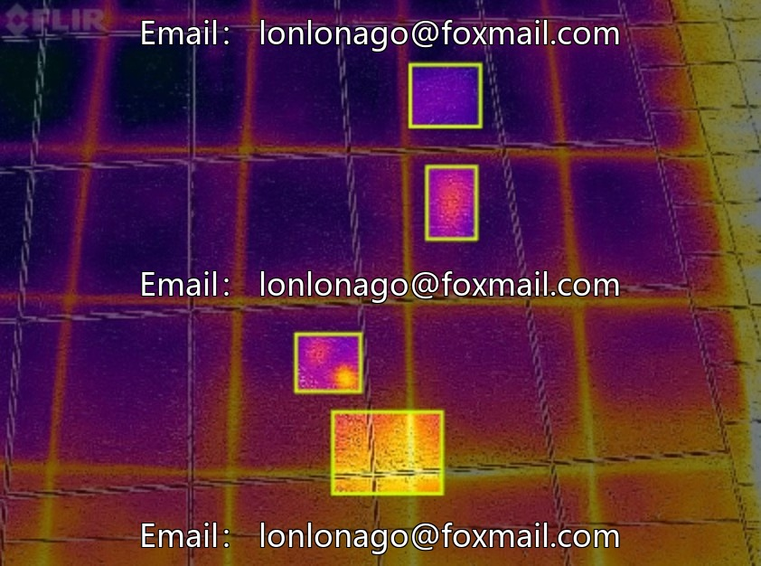
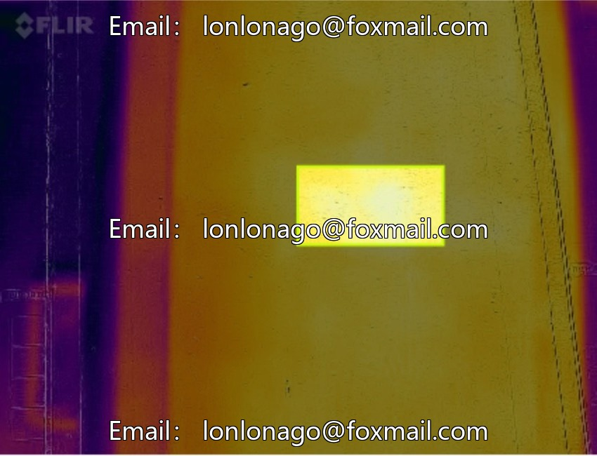
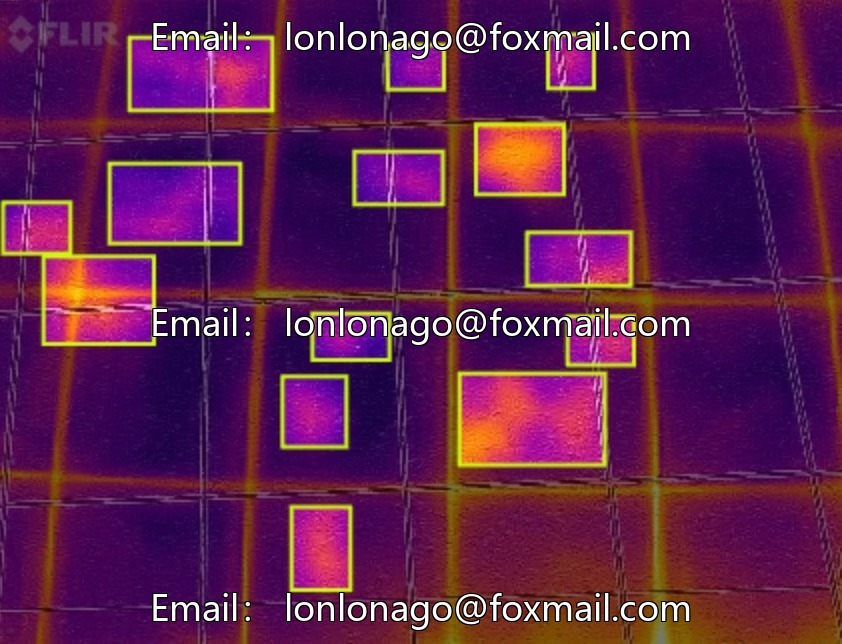

# Building Thermal Imaging Detection Dataset, 200 thermal imaging images, YOLO format annotations

## Body

Building Thermal Imaging Detection Dataset, 200 thermal imaging images, YOLO format annotations, supports model training and algorithm validation.

The dataset includes scenarios such as exterior wall insulation defects, pipe heat loss, and building surface temperature identification, categorized as Class 1 (supplementary annotation can be provided). It reserves expansion space suitable for different building types' inspection needs.

The dataset can provide the foundational training data for building thermal performance testing, energy consumption anomaly localization, and insulation layer defect identification systems, aiding in the intelligent detection of building energy efficiency. It supports the rapid localization of areas with abnormal energy consumption, reducing the cost of manual inspections.

Virtual materials, once sold, are non-refundable.
Interested friends, click "I want" to proceed.

## Images

## Payment

Here is a pay link on Stripe ( https://buy.stripe.com/3cs8yP7sY87d0vu9AB ). Please contact me lonlonago@foxmail.com after funding $89, and I will send you a complete data files , thank you!

